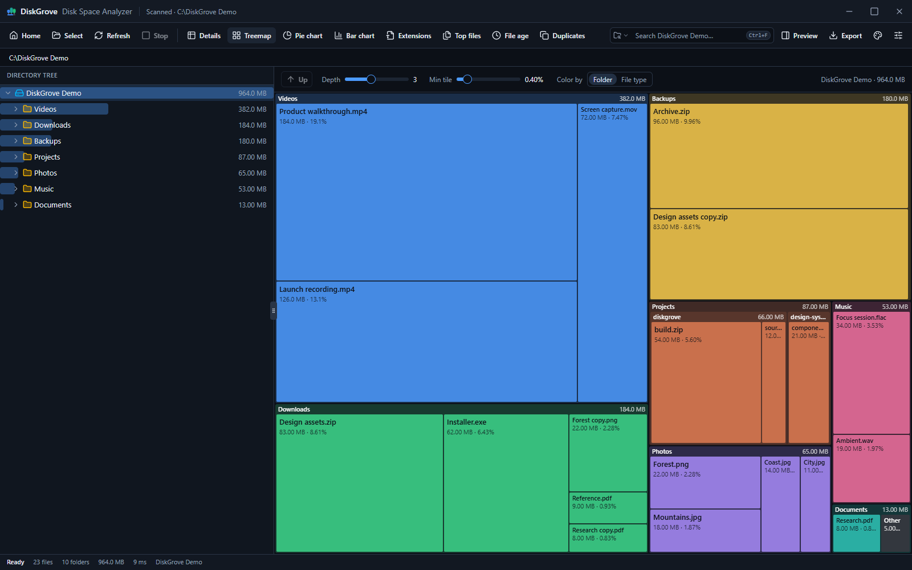
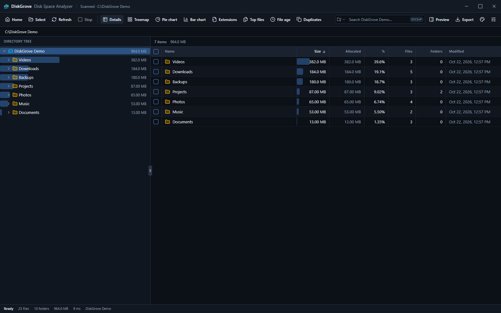
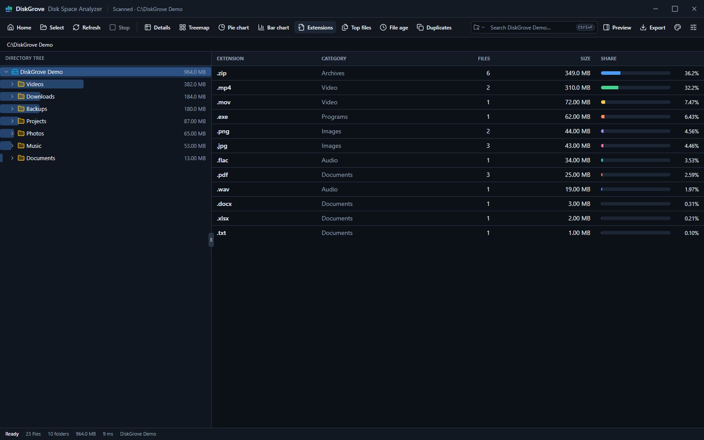
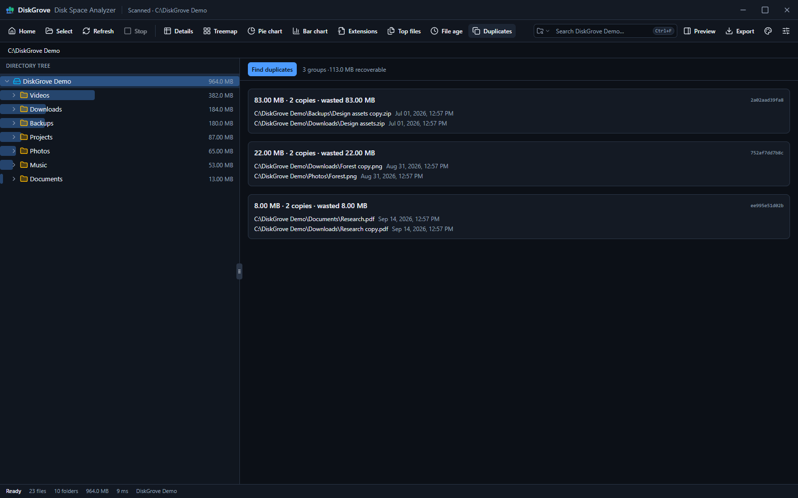

# DiskGrove

DiskGrove is a disk space analyzer built with Electron, React and TypeScript.
Packaging targets Windows, macOS (beta), Linux and Android (beta). The Android
app runs the same interface and scanner in a Capacitor shell.

DiskGrove is free and open source, and works the same way on every platform it
supports. Everything stays on your device: there is no account, telemetry or
cloud service. You can preview a file before deleting it, and nothing is opened
or deleted without your confirmation.



## What it does

- Browse folder sizes in a tree, table, treemap, pie chart or bar chart.
- Explore file extensions, modification ages and the largest files.
- Search file and folder names in the selected folder or across the entire scan.
  Plain text matches anywhere in a name; with `*` or `?` the whole name must
  match. Matching ignores case and Unicode normalization differences. Results
  update while a scan runs, and the largest 2,000 are listed with the total count.
  Press Ctrl+F (⌘F on macOS) to search.
- Find duplicate content using SHA-256, with full-file verification after sampling.
- Preview the selected file in a side pane: images, video, audio, PDF, text and code,
  CSV, Word, Excel, PowerPoint and ZIP contents, with dates, dimensions, duration and
  document properties. Previews are read-only and never run file content.
- Export CSV, JSON or a standalone HTML report.
- Reveal items in the file manager, open them, or move them to Trash / Recycle Bin.
  Permanent deletion is also available. Opening and deletion require a native
  confirmation dialog. See [Android](#android) for what differs there.

| Details                                                                       | Extensions                                                                             | Duplicates                                                                             |
| ----------------------------------------------------------------------------- | -------------------------------------------------------------------------------------- | -------------------------------------------------------------------------------------- |
| [](docs/screenshots/details.png) | [](docs/screenshots/extensions.png) | [](docs/screenshots/duplicates.png) |

## Install

Download the installer for your system from
[Releases](https://github.com/tanmay-73/diskgrove/releases):

| System                      | File                                        |
| --------------------------- | ------------------------------------------- |
| Windows (x64)               | `DiskGrove-<version>-win-x64.exe`           |
| macOS (Apple silicon, beta) | `DiskGrove-<version>-mac-arm64.dmg`         |
| macOS (Intel, beta)         | `DiskGrove-<version>-mac-x64.dmg`           |
| Linux (x64)                 | `DiskGrove-<version>-linux-x86_64.AppImage` |
| Debian, Ubuntu (x64)        | `DiskGrove-<version>-linux-amd64.deb`       |
| Android 7.0 or later (beta) | `DiskGrove-<version>-android.apk`           |

The macOS and Android builds are in beta. Please report any problems in
[Issues](https://github.com/tanmay-73/diskgrove/issues).

Each file has a `.sha256` checksum beside it. Check a download with
`sha256sum -c <file>.sha256` on Linux, `shasum -a 256 -c <file>.sha256` on macOS,
or compare the output of `Get-FileHash <file>` in PowerShell on Windows.

The builds are not code-signed, so the operating system warns before the first
launch:

- **Windows:** SmartScreen shows "Windows protected your PC". Choose
  **More info**, then **Run anyway**.
- **macOS:** after dragging DiskGrove to Applications, macOS refuses to open it
  because it cannot verify the developer. Open **System Settings > Privacy &
  Security** and choose **Open Anyway** next to the DiskGrove message. If macOS
  instead reports that the app "is damaged", run
  `xattr -cr /Applications/DiskGrove.app` in Terminal and open it again.
- **Linux:** make the AppImage executable with
  `chmod +x DiskGrove-*.AppImage`. AppImages need FUSE 2, which Ubuntu 22.04 and
  later do not install by default: install `libfuse2t64` (Ubuntu 24.04 and later)
  or `libfuse2` (Ubuntu 22.04). Without it, run the AppImage with
  `APPIMAGE_EXTRACT_AND_RUN=1` set, which unpacks it to a temporary folder on
  each launch.
- **Debian and Ubuntu:** install the package with
  `sudo apt install ./DiskGrove-*-linux-amd64.deb`, which also installs its
  dependencies. DiskGrove then appears in the applications menu and runs as
  `diskgrove` from a terminal. It installs to `/opt/DiskGrove`.
- **Android:** open the APK on the device and allow your browser or file manager
  to install unknown apps when Android asks. Google Play Protect may warn about
  an app from an unknown developer. The APK is signed with a key generated for
  each release, so Android refuses to install a new version over an old one:
  uninstall DiskGrove first, which also clears its settings and recent scans.

### Android

The Android app keeps DiskGrove's folder analysis and adds what a storage app on
a phone needs: where space goes by kind of file, which apps take it, and quick
ways to free it. It has no network permission.

On first launch DiskGrove explains each kind of access it can use. Every switch
opens the matching Android setting; turn it on there and come back, or continue
with less. The shield button on the home screen shows this list again.

- **All files access** (`MANAGE_EXTERNAL_STORAGE`; the storage permission on
  Android 10 and earlier) lets DiskGrove measure every folder in shared storage,
  sort files by kind and delete the ones you pick. This is the most access to
  files Android gives any app.
- **Usage access** shows each app's code, data and cache sizes, and when you
  last opened it.
- **See installed apps** and **Request uninstalls** are granted at install.

The home screen has three tabs:

- **Storage:** used and free space, split into apps, images, videos, audio,
  documents, other files and system. Each kind opens a list of its largest
  files with thumbnails, to open, share or delete. **Analyze folders** scans
  internal shared storage, an SD card or USB drive, or one folder, with the
  desktop app's tree, treemap, charts, search and duplicate finder.
- **Apps:** every installed app with its size, filtered to installed, unused,
  system or all apps and sorted by total, cache or data size, last use or name.
  Opening an app shows its figures, with Android's App info screen (where
  Android lets you clear an app's cache or storage) and uninstall dialog.
- **Clean:** app caches, unused apps, large files, old screenshots, downloads,
  installer files, files in the trash, duplicate files, and Android's own
  **Free up space** screen.

Android limits what any app can do, including DiskGrove:

- Other apps' private folders, such as those in `Android/data` and
  `Android/obb`, cannot be read even with All files access. Android reports
  their sizes on the Apps tab without exposing their contents. Its app-size
  figure includes OBB files; data and cache are shown separately.
- Only Android's App info screen can clear one app's cache. **Clear shared
  caches** asks Android to clear what every app caches in shared storage.
- Uninstalling always goes through Android's confirmation dialog.
- Deletion is permanent. Android has no Trash for files deleted this way.
- **Select folder** uses the system folder picker, which on Android 11 and later
  cannot pick a drive's root or its `Download` folder: scan the drive from its
  card instead, and use **Scan this folder** on any folder in the results.

In a folder scan:

- **Open** passes a file to another app through the system chooser, and
  **Share** sends files to another app. On a folder, Open browses into it in
  DiskGrove; there is no reveal in a file manager.
- Exports are saved through the system file picker.
- The Back button closes dialogs and menus, returns from the folders or preview
  pane, and goes up one folder at a time to the scan root, then back to the
  home screen. On the home screen it clears a selection, leaves a list, returns
  to the Storage tab and then puts DiskGrove in the background.

DiskGrove targets Android 17 (API 37) and runs on Android 7.0 and later. It
is distributed as an APK on GitHub rather than on Google Play, whose policy
limits All files access and the full app list to a few kinds of app.

## Development

Install Node.js 22.12 or newer (Node 24 LTS is used in CI) and npm, then:

```sh
npm ci
npm run dev
```

```sh
npm run check         # formatting, TypeScript and regression tests
npm run build        # compile main, preload and renderer into out/
npm audit            # include build tools, bundled libraries and the Electron runtime
```

Use `npm run format` to apply formatting.

## Packaging

```sh
npm run pack         # unpacked app in release/
npm run dist         # installer for the current platform
```

The configured targets are Windows NSIS, macOS DMG (Apple silicon and Intel,
in beta) and Linux AppImage and .deb. Build on the target operating system. Signing and
notarization are not configured, so local artifacts are unsigned. Pushing a
version tag builds all three, and the Android APK, in GitHub Actions; see
[Releasing](CONTRIBUTING.md#releasing).

The Windows installer registers an uninstaller and the .deb is removed with apt.
The macOS and Linux builds also bundle `resources/uninstall.sh`; see
[Uninstalling](#uninstalling).

### Android

Building the APK needs JDK 21 and the Android SDK with platform 37, found
through `ANDROID_HOME` or `android/local.properties`:

```sh
npm run android:apk  # signed APK in android/app/build/outputs/apk/release/
```

The release build is signed with the build machine's debug key, which Gradle
creates in `~/.android` when it is missing. See
[Android development](CONTRIBUTING.md#android) for the emulator workflow.

## Uninstalling

Every uninstaller asks whether to remove your settings and recent scans too.
They live in `settings.json` in the data folder; the caches beside it always go.

On Windows, uninstall from **Settings > Apps** or run `Uninstall DiskGrove.exe`
in the install folder. This removes the program files, shortcuts, registry
entries, the cached installer in `%LOCALAPPDATA%\diskgrove-updater` and the
data folder `%APPDATA%\diskgrove`. A silent uninstall (`/S`) keeps the settings
unless `--delete-app-data` is passed. Installing a newer version over an existing
one keeps everything.

The macOS app and the AppImage have no installer, so they carry an uninstall
script instead. It lists what it will delete and asks before deleting. `-y` skips the
questions and keeps the settings; add `--delete-app-data` to remove them.

```sh
# macOS
sh /Applications/DiskGrove.app/Contents/Resources/uninstall.sh

# Linux, from the folder that holds the AppImage
./DiskGrove-1.0.0-linux-x86_64.AppImage --appimage-extract resources/uninstall.sh
sh squashfs-root/resources/uninstall.sh
```

On macOS this removes the app and its files under `~/Library` (the data folder
`Application Support/diskgrove`, caches, preferences, logs and saved window
state). On Linux it removes the AppImage, the data folder `~/.config/diskgrove`,
`~/.cache/diskgrove` and any menu entry added by AppImageLauncher or appimaged.
If the AppImage is somewhere the script does not look, pass its path as an
argument.

For the .deb package, run the bundled script first if you also want your data
removed, then remove the package. apt removes the program files, the menu entry,
the `diskgrove` command and the AppArmor profile, but not the data in your home
directory.

```sh
sh /opt/DiskGrove/resources/uninstall.sh
sudo apt remove diskgrove
```

On Android, uninstall DiskGrove like any other app. Android removes its settings
and recent scans with it; exported reports stay where you saved them.

## Scan behavior and limits

Scans are snapshots. Stopping a scan keeps the partial results: the status bar
and title bar mark them as partial, and the scan is not added to recent scans.
Rescan after changes outside DiskGrove.

Items DiskGrove cannot read, such as folders the account may not open, are left
out of the sizes. The status bar counts them; click the count to list them.
Folders that could not be read are marked in the tree and the details table.
Items deleted while the scan runs are not counted.

Symbolic links and junctions are skipped by default. Enabling **Follow links**
includes their targets and stops directory cycles. Shared targets may be counted
more than once. File actions through linked directories are refused; scan the
target directly to manage those files.

On Linux, kernel virtual filesystems such as `/proc` and `/sys` are listed but
not scanned unless one is chosen as the scan root: their files report sizes that
are not stored anywhere. On macOS, `/dev` is treated the same way, and folders
that the system volume shares with `/System/Volumes/Data` are counted once, under
their usual paths such as `/Users`.

Allocated size uses filesystem block counts where available and otherwise
estimates with 4 KiB blocks. Duplicate savings are estimates: hard links,
compression and reflinks can make the actual recoverable space smaller. Scans
keep metadata in memory: about 250 MB of RAM per million files and folders.

The app has no telemetry or cloud service. Recent scan paths are saved locally
in Electron's user-data directory, or the app's private storage on Android, and
on desktop stay there after uninstalling unless you choose to remove them.
Reports contain filenames and full paths; review them before sharing.

## Contributing

See [CONTRIBUTING.md](CONTRIBUTING.md) for the source layout, checks and manual
test procedure. Security boundaries and reporting instructions are in
[SECURITY.md](SECURITY.md).

Licensed under [MIT](LICENSE).

UI components are adapted from [shadcn/ui](https://github.com/shadcn-ui/ui).
See [third-party notices](THIRD_PARTY_NOTICES.md) for the upstream copyright
and license. Packaged builds also include `THIRD_PARTY_LICENSES.txt`, which lists
every bundled library with its license.
